# Silent Failure Detection in Distributed Systems
### Using Google Borg Cluster Traces

A data-science study of whether resource-utilisation, machine-level and temporal
behaviour in Google Borg cluster traces can reveal **silent system degradation** —
deterioration that happens without any explicit failure being reported.

---

## Research question

> Can resource-utilization, machine-level, and temporal behaviour in Google Borg
> cluster traces be used to identify patterns associated with silent system
> degradation before an explicit failure occurs?

---

## Read this before anything else

**This trace contains no ground truth for silent failure.**

The dataset has a `failed` column. An automated purity audit proved it is exactly
equivalent to `event == 'FAIL'`, and to `instance_events_type == 2`, and to
`collections_events_type == 2`. It is an **explicit** failure flag — and an
explicitly reported failure is, by definition, not silent.

So the project splits into two genuinely different tasks:

| | Task | Label | What is claimed |
|---|---|---|---|
| **A** | Explicit failure prediction | `failed` | measured, leakage-audited classification performance |
| **B** | Silent degradation | **none exists** | a transparent unsupervised index, validated *indirectly* |
| **C** | Anomaly detection | none | ranked behavioural outliers, cross-checked against `failed` |
| **D** | Explainability | — | what drives A and B |

Nothing in this project claims a silent-failure detection rate. What it delivers
is a **validated methodology** plus an honest statement of where the data runs
out. Where the evidence is absent, the reports say *"insufficient evidence from
the available trace data"* rather than filling the gap.

---

## Quick start

```bash
pip install -r requirements.txt
```

Place the trace at `data/raw/borg_traces_data.csv`, then:

```bash
python run_project.py
```

That runs all ten stages and writes every figure, table, metric and report. For a
fast check on a subsample first:

```bash
python run_project.py --sample 40000
```

Dashboard (after the pipeline has run at least once):

```bash
streamlit run dashboard/app.py
```

Tests — these need no dataset at all, they run on a synthetic frame that
reproduces the real schema:

```bash
pytest -q
```

### Command-line options

| Flag | Effect |
|---|---|
| `--sample N` | analyse a random N-row subsample (also `SFD_SAMPLE_ROWS=N`) |
| `--from cleaned` / `--from feature` | reuse cached processed data, skip earlier stages |
| `--skip-heavy` | shrink SVM / KNN / Gradient Boosting / One-Class SVM to tiny subsamples |

Individual components can also be run on their own once
`data/processed/feature_dataset.csv` exists:

```bash
python -m experiments.explicit_failure
python -m experiments.silent_failure_analysis
python -m experiments.anomaly_detection
```

---

## Project architecture

```
SILENT-FAILURE-DETECTION/
│
├── data/
│   ├── raw/                 # Original Borg dataset (not uploaded)
│   └── processed/           # Generated datasets (not uploaded)
│
├── src/                     # Core processing pipeline
│   ├── data_loader.py
│   ├── data_validation.py
│   ├── preprocessing.py
│   ├── feature_engineering.py
│   ├── target_engineering.py
│   ├── anomaly_detection.py
│   ├── models.py
│   ├── evaluation.py
│   ├── explainability.py
│   ├── temporal_analysis.py
│   ├── visualization.py
│   └── complete_R_analysis.R
│
├── experiments/             # Independent experiments
│   ├── explicit_failure.py
│   ├── silent_failure_analysis.py
│   └── anomaly_detection.py
│
├── dashboard/
│   └── app.py               # Streamlit dashboard
│
├── tests/                   # Automated tests
│
├── outputs/                 # Local generated outputs
│
├── results/
│   ├── figures/             # Visualisations
│   └── metrics/             # Evaluation CSV files
│
├── docs/                    # Final project report
├── presentation/            # Final PowerPoint
│
├── run_project.py
├── requirements.txt
├── .gitignore
└── README.md

---

## Model Performance

Models were evaluated using grouped validation to reduce the risk of
overly optimistic results caused by related records appearing in both
training and testing data.

| Model | Accuracy | F1-score | ROC-AUC | PR-AUC |
|---|---:|---:|---:|---:|
| Random Forest | 0.8321 | 0.5185 | 0.8101 | 0.5275 |
| SVM (RBF) | 0.8130 | 0.5269 | 0.8382 | 0.5010 |
| XGBoost | 0.8155 | 0.4743 | 0.8166 | 0.4342 |
| Decision Tree | 0.7688 | 0.5194 | 0.7874 | 0.4260 |
| Logistic Regression | 0.7558 | 0.4840 | 0.7805 | 0.4277 |
| KNN | 0.7930 | 0.4756 | 0.7488 | 0.3627 |
| Gradient Boosting | 0.7619 | 0.3777 | 0.7455 | 0.2751 |

### Grouped-temporal evaluation

XGBoost achieved:

- Accuracy: 86.37%
- F1-score: 0.5709
- ROC-AUC: 0.8842
- PR-AUC: 0.6840

These results predict the available explicit-failure label,
not independently verified silent failures.

## Pipeline stages

`python run_project.py` prints each stage as `[n/10]`:

| | Stage | Key output |
|---|---|---|
| 1 | Load the raw trace | logical vs physical line count |
| 2 | Profile + **leakage audit** | `outputs/reports/data_profile.txt`, `leakage_audit.txt` |
| 3 | Preprocess | `data/processed/cleaned_dataset.csv`, `preprocessing_report.txt` |
| 4 | Engineer features | `feature_dataset.csv`, `feature_registry.csv` |
| 5 | **Degradation index** | `silent_failure_risk.csv`, `silent_failure_report.txt` |
| 6 | Anomaly detection | `anomaly_summary.csv`, `anomaly_report.txt` |
| 7 | Model across 3 split protocols | `model_comparison.csv`, `split_protocols.csv` |
| 8 | Explainability | `feature_importance.csv`, `permutation_importance.csv` |
| 9 | Temporal + machine analysis | `temporal_trends.csv`, `machine_risk_ranking.csv` |
| 10 | Figures + reports | 24 figures, `PROJECT_REPORT.md`, `final_results.txt` |

---

## The three leakage traps in this dataset

This is the part of the project worth defending at a viva, because each trap
produces a *better-looking* result than the honest one.

**1. Target re-encoding.** `event`, `instance_events_type` and
`collections_events_type` are deterministic re-encodings of `failed`. A model
given any of them reports near-perfect accuracy having learned nothing. All
three are banned in `config.TARGET_LEAKAGE_COLS`, and a test asserts they never
reach a feature matrix.

**2. Join-induced replication.** Usage measurements were joined onto events, so
identical feature vectors repeat across rows and a collection's rows nearly
always share one label. Under a random split, near-duplicates of test rows sit in
training. The pipeline therefore runs **three split protocols on identical
features and models** so the only thing that varies is the split — and reports
the gap. On a 40,000-row subsample, Random Forest scored ROC-AUC **0.997** under
a random split and **0.810** under a grouped split. The first number is
memorisation, and it is the easiest fraudulent result available in this dataset.
Headline numbers use `grouped`.

**3. Time sentinels.** Borg encodes *before the trace window* as `time = 0` and
*after* as `2^63-1`. Rows with `time = 0` fail at **0.657** against **0.159** for
real timestamps, so a raw `time` feature is a pseudo-oracle for trace-boundary
bookkeeping. Sentinels become `NaN` plus an honest `time_is_valid` flag; raw time
columns are excluded from models.

---

## How the degradation index avoids inventing weights

Six components — CPU stall pressure, memory pressure, resource variability, tail
latency pressure, telemetry incompleteness, provisioning mismatch — each
rank-normalised to `[0,1]` because the raw indicators have incompatible units.

Rather than defend an arbitrary weight vector, **three independent combination
rules are computed and compared**:

| Scheme | Where the weights come from |
|---|---|
| `equal` | principle of indifference — no evidence justifies unequal weights |
| `pca` | \|first principal component loadings\|, learned from the data's covariance |
| `mahalanobis` | multivariate outlyingness — weight-free by construction |

Their pairwise Spearman rank correlation is reported. High agreement means the
conclusions are **robust to the weighting choice**, which is a stronger claim
than defending any single vector.

No component uses `failed`, so measuring the index against `failed` afterwards is
an **external** construct-validity test rather than a circular one.

---

## Honest limitations

1. **No silent-failure label.** Every silent-failure result is a methodology
   demonstration plus indirect validation, never a measured detection rate.
2. **Event-sampled, not continuous telemetry.** "Before the failure" can only
   mean "an earlier event of the same collection".
3. **Severe per-machine sparsity** (median ≈ 4 events/machine) — so no
   per-machine rolling degradation curves are claimed; trend analysis runs at the
   collection and cluster-hour grain instead.
4. **A join, not a clean panel** — replication limits effective sample size far
   below the row count.
5. **Normalised, unitless resources** — no absolute capacity statements.
6. **One trace window, eight cells** — generalisation is untested.
7. **Contamination is assumed** (5%), not estimated; the anomaly *ranking* is the
   robust output.
8. **Unknown calendar alignment** — hence `is_weekend_like`, not `is_weekend`.

---

## A parsing detail worth knowing

`wc -l` reports **1,324,695** lines for a file with **405,894** records.
`cpu_usage_distribution` stores a NumPy array *repr* that wraps across several
physical lines inside a quoted field, so any line-based reader mis-parses this
file. All counts here come from the CSV parser, never from line counting.

---

## Reproducibility

`config.RANDOM_STATE = 42` is fixed for every split, model, subsample and
detector. Re-running reproduces the numbers. `PROJECT_REPORT.md` is generated
from the run's actual results — regenerate it, don't edit it.

---

## Project Visualisations

The following visualisations demonstrate the exploratory analysis, resource behaviour, anomaly detection, and machine-learning evaluation performed during the project.

### 1. Dataset Exploration

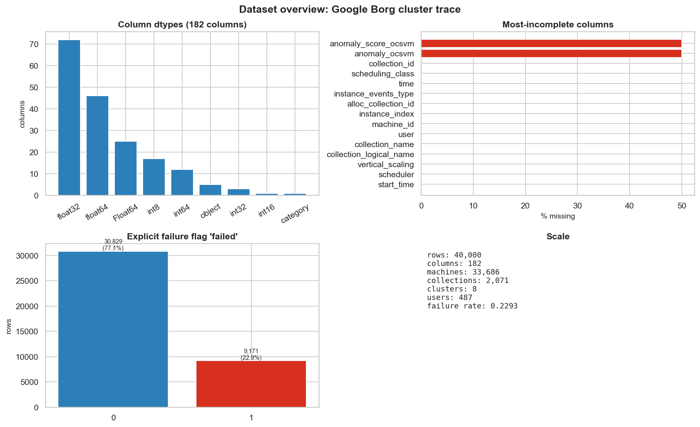

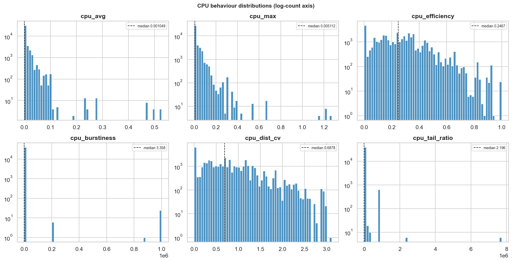

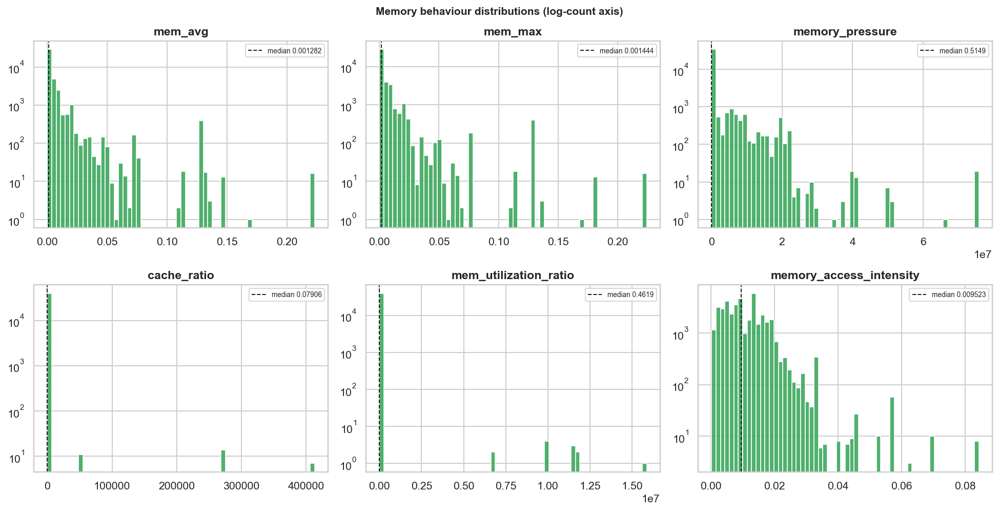

### 2. Failure and Risk Analysis

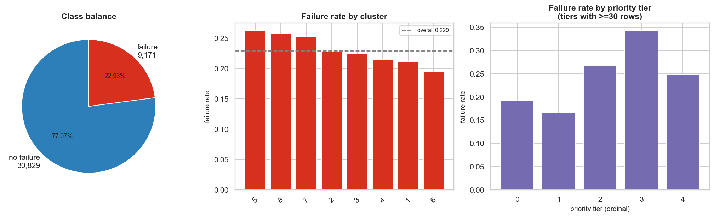

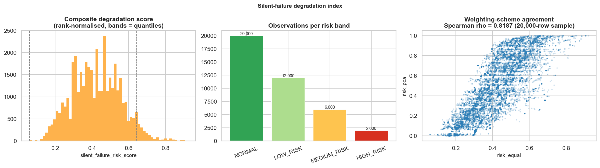

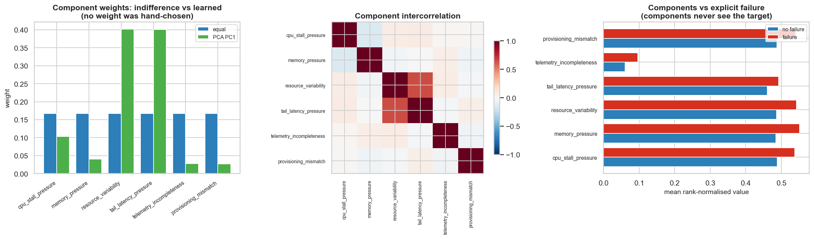

### 3. Anomaly Detection

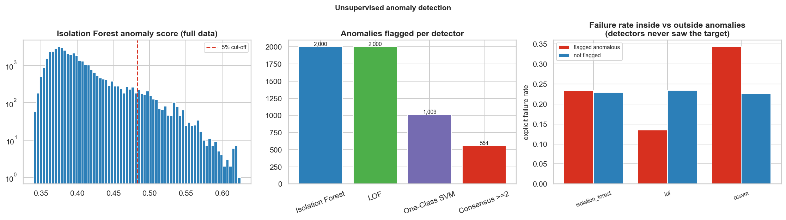

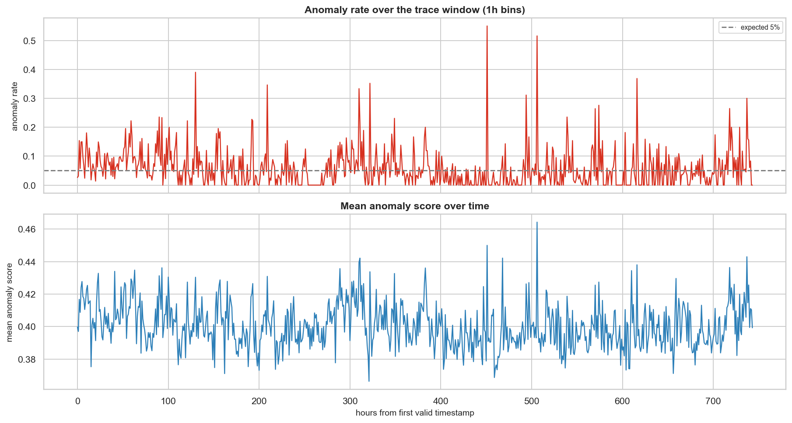

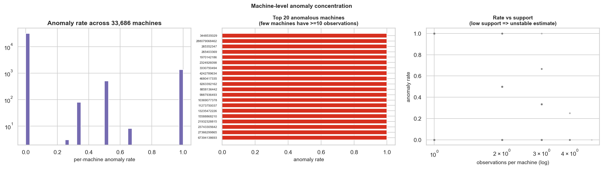

### 4. Machine Learning Evaluation

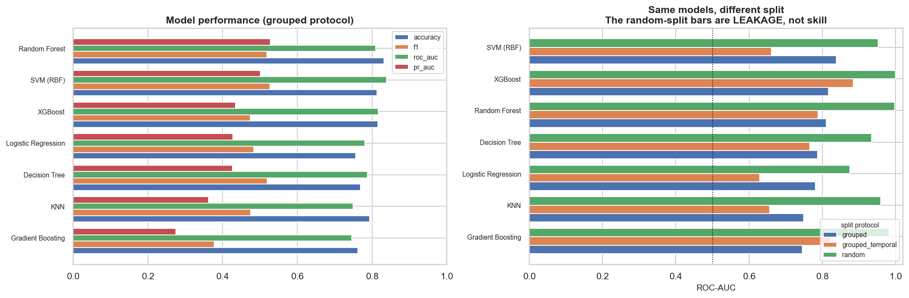

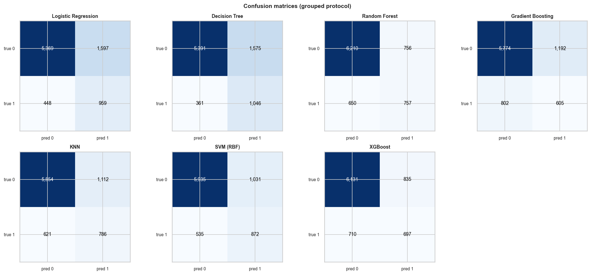

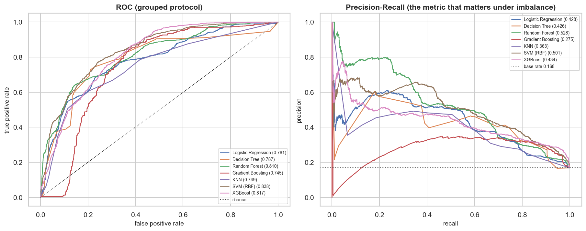

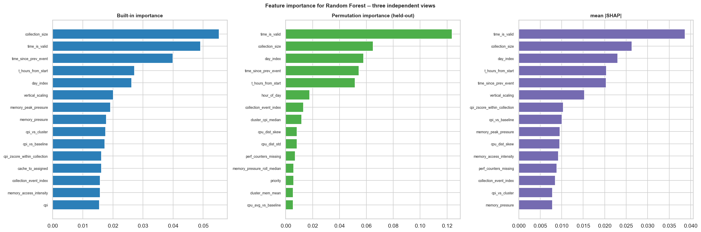

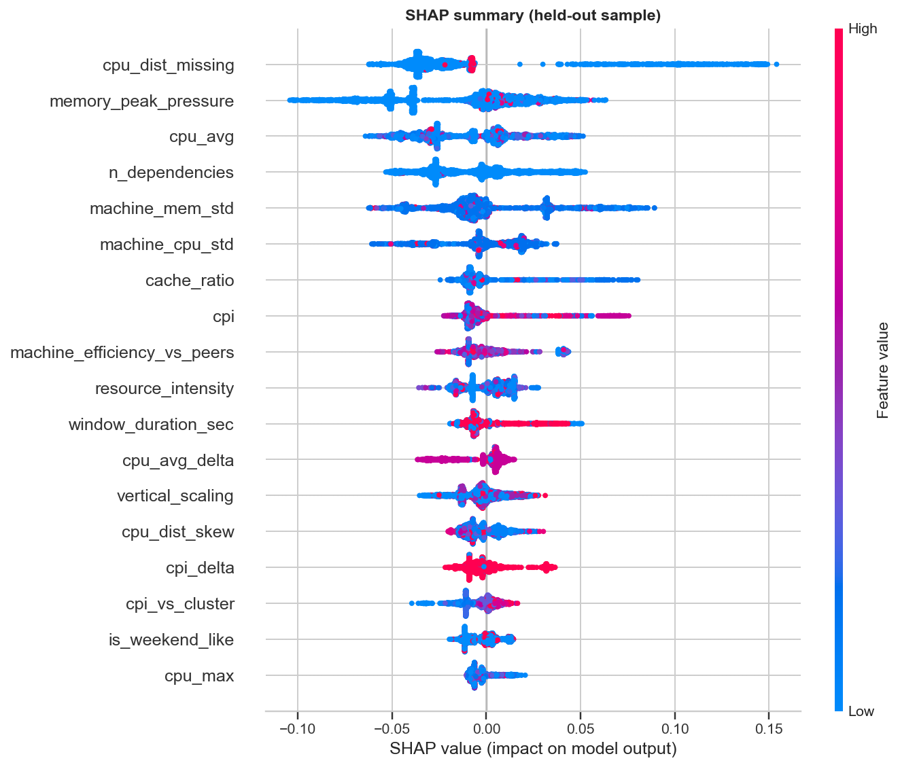

---

## Project Deliverables

- [Complete Project Report](docs/SILENT%20FAILURE%20DETECTION.docx)
- [Final Project Presentation](presentation/Silent_Failure_Detection_Project_Presentation.pptx)
- [Model Comparison Results](results/metrics/model_comparison.csv)
- [Anomaly Detection Results](results/metrics/anomaly_summary.csv)
- [Feature Importance Results](results/metrics/permutation_importance.csv)

---

## Future Scope

- Investigate independent ground-truth labels for silent failures.
- Validate the methodology on additional distributed-system traces.
- Improve temporal degradation modelling.
- Explore online anomaly detection and real-time monitoring.
- Extend the dashboard with live monitoring capabilities.

---

## Author

**Aditya Aryan Jha**

B.Tech – Computer Science and Engineering (Data Science)  
Vellore Institute of Technology, Chennai

GitHub: [@aajbelga](https://github.com/aajbelga)

